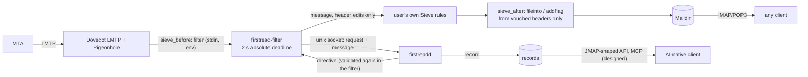
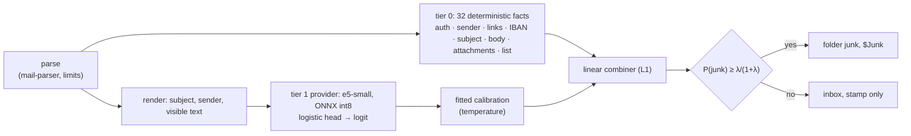
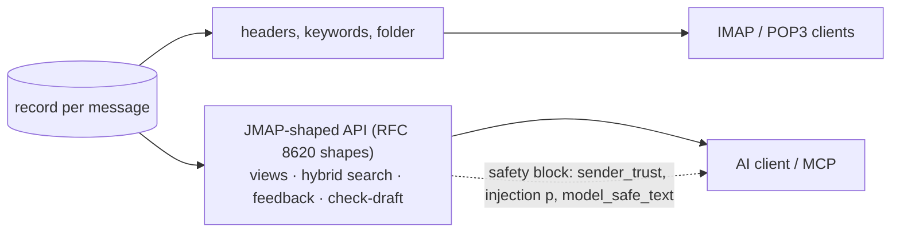
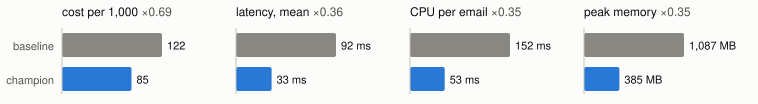
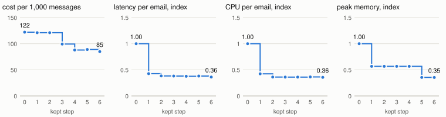

# firstread

A delivery-time mail classifier and organiser. It reads each message once, between the MTA and
the mailbox, and returns a **verdict plus a validated edit list** (headers, keywords, folder). It
never returns a rewritten message, and the body is never touched. Clients then only read,
post-process and draft.

Status: the delivery path, tier 0 and tier 1 run end to end in a lab, on public corpora and on real
Dovecot 2.3.21. Not deployed. Mailbox memory and the owner's feedback from Dovecot are built and
measured, not yet good enough to switch on; organisation and platform learning, the API and tier 2
are designed, not built ([status](#status)).

## What is different

| | how |
|---|---|
| output | a verdict plus an edit list; a small filter binary applies header edits only, and a byte-identical body is a test |
| header trust | no header in firstread's namespace that arrived with the message survives; Sieve acts only on headers the filter vouched for, and only after the user's own rules |
| models | every System-1 model is a *provider* behind one contract: typed questions in, logits out, decisions only through a fitted calibration, data rules checked per call, vectors never mixed across spaces |
| identity | authentication and sender identity are deterministic code (tier 0), never a model output |
| clients | the server owns safety, organisation and search; AI clients get them through a JMAP-shaped API and MCP, with a safety block per message (sender trust, injection probability, model-safe text) |
| tuning | a lab replays the real delivery path, and an autoresearch loop keeps a change only if quality, latency or footprint improves and none gets worse |

## Delivery path



Any failure takes the fallback: the message unchanged except that forged firstread headers are
removed, delivered as if firstread were not there. A daemon that hangs costs the 2 s deadline
(measured on Dovecot: delivered after 2.1 s). The deadline sits below `sieve_filter_exec_timeout` on
purpose: on Dovecot 2.3.21 a filter killed at that timeout makes LMTP panic and nothing is stored
([measurement](docs/measurements/2026-10-26-lab-v0.md#l2-the-real-dovecot-stack)).

## Classifier



λ is the cost of a legitimate message in Junk relative to spam left in the inbox, set by the owner
(100, so the threshold is 0.990). The provider contract ([14](docs/14-providers.md)) takes
decoder models answering many typed questions (JEV-style), embedding heads, or anything later.

## Clients

One record, two projections. IMAP and POP3 clients get the decision as headers, IMAP keywords and
Sieve folders, with nothing installed. AI-native clients do no filtering, filing or indexing of
their own: they read views, search and a per-message safety block from the server.



Dovecot serves no JMAP, so the API uses JMAP's shapes (session, `/get`, `/query`, `/changes`, push)
under a vendor capability; on a JMAP server it becomes extra properties on `Email`. An AI client
sees mail only as `model_safe_text` marked as untrusted data, loads no remote content, and takes
no action because a message asked for it ([15](docs/15-ai-native-clients.md)). Designed, not built.

## Results (lab, 2026-10-26)

Public corpora through the real delivery path (filter → daemon → sidecar) on a 2 vCPU / 7 GB
cloud VM. Dev split: 1,528 messages; the primary slice is SpamAssassin (615 ham, 49 hard ham,
303 spam), plus modern spam and ham from other sources and synthetic Dutch mail. Quality is the
cost per 1,000 primary messages at λ = 100. Reproduce: [lab/README.md](lab/README.md).

**Baseline against champion**, one interleaved timing pass (200 dev messages, wall time of the
filter process, every vector computed, no cache):

<picture>
  <source media="(prefers-color-scheme: dark)" srcset="docs/img/head-to-head-oct26b-dark.svg">
  
</picture>

| | baseline | champion | change, CI95 |
|---|---|---|---|
| cost per 1,000 (dev) | 122.0 | 84.8 | −37.2 [−50.7, −24.8] |
| legitimate in Junk, dev (of 937) | 0 | 0 | |
| latency per email, mean (p99) | 92 ms (151) | 33 ms (56) | ×0.36 [0.34, 0.37] |
| CPU per email | 152 ms | 53 ms | ×0.35 [0.34, 0.36] |
| peak memory, sidecar + daemon | 1,087 MB | 385 MB | ×0.35 |

Both run multilingual-e5-small. Baseline: PyTorch fp32, 256 tokens, L2 combiner (C=1). Champion:
ONNX Runtime int8, 192 tokens, SentencePiece tokenizer, L1 combiner (C=4).

**The loop:** 21 changes tried (22 runs, one repeated after noise), 6 kept, plus 4 reference runs.
A change is kept only when quality, latency or footprint improves beyond noise and none gets worse
(paired bootstrap for quality, ratio-of-means CI for time and memory; an A/A check gave ×0.999
[0.976, 1.023]).

<picture>
  <source media="(prefers-color-scheme: dark)" srcset="docs/img/loop-oct26b-dark.svg">
  
</picture>

| step | change | quality Δ per 1,000, CI95 | latency | CPU | memory |
|---|---|---|---|---|---|
| 1 | ONNX Runtime int8 instead of PyTorch fp32 | equal | ×0.43 | ×0.42 | ×0.57 |
| 2 | 192 tokens instead of 256 | equal | ×0.90 | ×0.86 | equal |
| 3 | combiner C=2 | −21.7 [−31.0, −13.4] | equal | equal | equal |
| 4 | combiner L1 penalty | −11.4 [−18.6, −5.2] | equal | equal | equal |
| 5 | SentencePiece instead of HF `tokenizers` | equal | equal | equal | ×0.63 |
| 6 | combiner C=4 (L1) | −4.1 [−8.3, −1.0] | equal | equal | equal |

Refused trades: ONNX fp32 (memory ×1.10), one thread (latency ×1.32), 128 or 160 tokens (a
legitimate message in Junk), static potion embeddings (latency ×0.25, but cost +18.6 and memory
×4.9). All runs: [measurement](docs/measurements/2026-10-26-lab-pareto-loop.md).

**Sealed split, one query** (1,914 messages never used for any choice): **350 per 1,000**, against
85 on dev. Three of the 25 hard-ham messages (legitimate mail that reads as commercial) went to
Junk: 300 of the 424 cost units. Spam missed: 33 % (dev 27 %). The baseline has not been run on the
sealed split (one query per tag), so whether the quality gain holds out of sample is open.

**λ.** The same query swept λ over a list fixed beforehand; nothing was chosen from it:

| λ | threshold | legitimate in Junk (of 830) | spam missed (of 380) |
|---|---|---|---|
| 9 | 0.900 | 7 | 74 (19 %) |
| 20 | 0.952 | 4 | 99 (26 %) |
| 50 | 0.980 | 3 | 113 (30 %) |
| **100** | **0.990** | **3** | **124 (33 %)** |
| 999 | 0.999 | 1 | 202 (53 %) |

λ is a price, not a parameter to fit: it depends on whether anyone looks in Junk. Androutsopoulos
et al. use 9 when the sender is told and can resend and 999 when blocked mail is deleted
([2000](https://arxiv.org/abs/cs/0006013)); a Junk folder lies between. Here 100 → 20 costs one
more legitimate message in Junk and keeps 25 more spam out of the inbox. The hard-ham errors barely
respond to λ (3 at 100, 1 at 999): they are confident mistakes, a model problem.

Limits: SpamAssassin is 2002–2005 English mail, the Dutch slice is synthetic, and the
false-positive side rests on 49 dev and 25 sealed hard-ham messages.

## Mailbox memory (lab, 2026-10-27)

Per mailbox, firstread remembers what was delivered and what the owner did: moved into Junk, out of
Junk, or wrote to someone (Dovecot IMAPSieve, real Dovecot 2.3.21). Addresses, Message-IDs and IBANs
are stored as keyed hashes only. Memory adds inputs to the combiner, fitted on top of the combiner
without memory, so mail from a stranger is decided exactly as before (checked on the 385 dev
messages without history).

| owners (simulated, act on true labels) | Δ cost per 1,000 vs memory off (dev), CI95 | legitimate newly in Junk |
|---|---|---|
| active: 80 % of junk moved, 90 % rescued, 10 % replied | −8.3 [−14.5, −2.1] | 0 |
| passive: 30 %, 50 %, no replies | −2.1 [−8.3, +3.1] | 0 |
| never act | +4.1 [+1.0, +8.3] | 0 |

Not kept: the rule asks for a gain under several owner profiles, and with owners who never act,
delivery counts alone cost spam caught. Not safe to switch on either: history keys on the From
address, so it must first be tied to verified identity. One mailbox never affects another
(poisoning check: 0.0). [Measurement](docs/measurements/2026-10-27-mailbox-memory.md).

## Status

| built and measured | designed, not built |
|---|---|
| parser, tier-0 facts, IBAN mod-97, link analysis, trusted `Authentication-Results` | SPF/DKIM/DMARC/ARC evaluation with recorded DNS |
| provider contract, calibration, combiner, stamp with HMAC, record | tier 2 (decoder model) and the async queue |
| `firstread-filter` (fallback, deadline), `firstreadd` (sidecar, records, `--shadow`) | API (JMAP shapes), MCP server, safety block |
| lab: L1 harness, L2 on Dovecot 2.3.21, three-axis loop, sealed split | learning per organisation / platform, commons |
| mailbox memory (keyed hashes, event log), owner feedback via IMAPSieve (hook D), learning test | memory history read only for verified identities; hook C, digest |

## Repository

```
crates/   Rust: core contract, parse, auth, links, pipeline, filter, daemon, CLI (+ stubs for the rest)
ml/       Python: tier-1 sidecar (providers, ONNX export, server), heads and combiner training
lab/      the lab: harness, loop, L2 Dovecot setup, data references, results; lab/README.md reproduces it
docs/     design 00–15, decisions/ (ADRs), measurements/
```

Checks: `cargo fmt --check && cargo clippy --all-targets -- -D warnings && cargo test`.
Lab: `sh lab/reproduce.sh <lab_data>` ([lab/README.md](lab/README.md)).

Design docs: [goal](docs/00-goal.md) · [architecture](docs/01-architecture.md) ·
[signals](docs/02-signals.md) · [client contract](docs/03-client-contract.md) · [models](docs/04-models.md) ·
[sending](docs/05-sending.md) · [security](docs/06-security-privacy.md) · [evaluation](docs/07-evaluation.md) ·
[learning](docs/08-learning.md) · [experience](docs/09-experience.md) · [commons](docs/10-commons.md) ·
[scale](docs/11-scale.md) · [interfaces](docs/12-interfaces.md) · [lab](docs/13-lab.md) ·
[providers](docs/14-providers.md) · [AI-native clients](docs/15-ai-native-clients.md)
